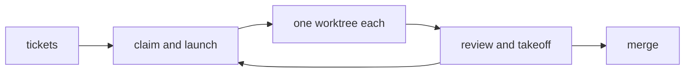

<p align="center">
  
</p>

# korapy

korapy runs fleets of headless coding agents on Linux hosts. It claims
tickets from a board, launches one agent per ticket under a shared
budget, and lands the work through review and merge.

[](https://github.com/apojomovsky/korapy/actions/workflows/ci)
[](LICENSE) [](pyproject.toml) [](docs/00-design.md) [](pyproject.toml) [](#status)

## What it does

korapy is the shared core for coding-agent fleets on one Linux host.
Each project brings its own board, eligibility rules and prompts;
korapy supplies the machinery every project needs unchanged: launching
agents as systemd user units, keeping their sessions, routing models
around exhausted quota, admitting work under one host budget, pacing
GitHub calls, and cleaning up without losing work. One dispatch pass
claims ready tickets and starts their agents; review and takeoff gate
the result; a single merger per repo lands it.



## Features

- Launch agents, not machines: one ticket becomes one agent in its own
  worktree, as a transient systemd unit.
- Stay inside one budget: a single host-wide cap, quota ledger and
  GitHub rate budget shared by every project.
- Route around dead quota: per-launch model chains skip exhausted
  providers, so a funded project keeps running.
- Keep the loop moving: drive syncs, claims, launches and mirrors on a
  timer, and proves nothing is lost before it deletes anything.
- Gate every landing: review records, takeoff checks and one merger
  per repo, with a read-only dashboard to watch it all.
- Headless runtimes, one major at a time: omp and muse.
- Grow past one host: a hub mode fences claims across machines behind
  the same tracker and forge interfaces.

## Requirements and install

Clone the repository:

```bash
git clone https://github.com/apojomovsky/korapy
```

You need [uv](https://docs.astral.sh/uv/). Everything else is checked,
with install commands, by korapy itself:

```bash
curl -LsSf https://astral.sh/uv/install.sh | sh   # if you do not have uv
make bootstrap    # Python, the locked environment, git hooks, then the host check
make install      # put korapy on your PATH
```

What else the host needs, and how to get it, is in the install section
of the operator's guide.

## Quickstart

From a checkout to a first passing loop (the full runbook is in
[`docs/guide.md`](docs/guide.md)):

```sh
make install         # korapy on your PATH
korapy deps          # ok per program, or the install command for what is missing
korapy init          # in a project clone: writes korapy.toml and registers the host
korapy doctor        # one row per check; every failure names its fix
korapy drive --plan  # what one pass would start
                     # project NAME: project NAME has no eligibility entry: skipped
                     # plan: 0 candidate(s), would start 0
korapy drive         # run the pass
                     # project NAME: project NAME has no eligibility entry: skipped
                     # pass: 0 candidate(s), started 0
korapy serve         # the dashboard, on loopback
                     # korapy serve: dashboard at http://127.0.0.1:8420/
```

## Opinions

- Linux only: every agent is a transient `systemd --user` unit.
- GitHub behind two interfaces: swap providers with an adapter, not a redesign.
- One ticket, one worktree, one branch: agents never share a checkout.
- One pool per host: a project below its floor still starts at a full host.
- Proof before removal: a delete happens only once nothing is lost.

Why, and how the pieces fit: [`docs/00-design.md`](docs/00-design.md).

## Documentation

- [Operator's guide](docs/guide.md): install, first run, the loop, troubleshooting
- [Design](docs/00-design.md): the problem, where the line falls, how the pieces fit
- [Onboarding](docs/01-onboarding.md): bringing a project in, inline or split
- [Command reference](docs/commands.md): every verb, flag and exit code
- [Configuration reference](docs/configuration.md): every setting, one place
- [Dashboard](docs/12-web-dashboard.md): the read-only web UI over the fleet
- [Heavy lane](docs/14-heavy-lane.md): weighted slots for bursty work
- [Contributing](CONTRIBUTING.md): setup, loop, review gate

## Status

Status: alpha. Working today: launching, resuming, tailing and stopping agents, the dispatch loop, review and takeoff, the dashboard.
Not yet: claims across hosts.

## License

MIT, see [`LICENSE`](LICENSE).
