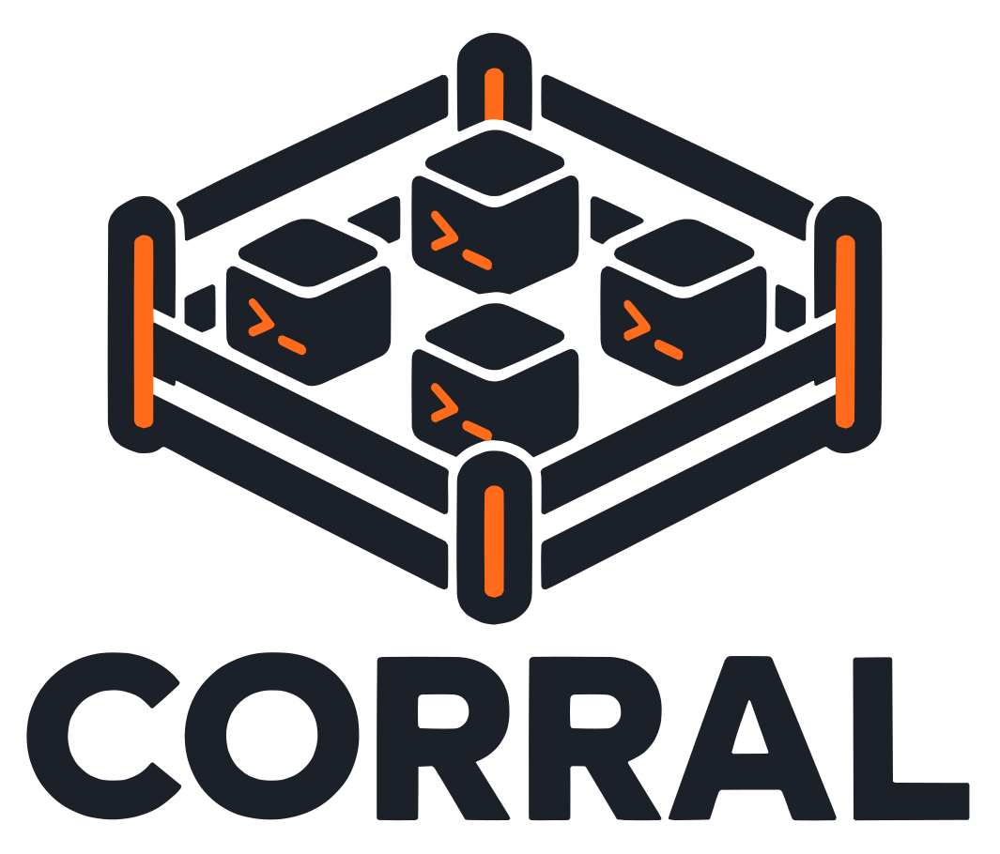

<p align="center">
  
</p>

# korapy

An opinionated core for running fleets of headless coding agents on Linux hosts.

You bring the projects: a board, the rules for which ticket is ready, the prompts. korapy keeps the agents in one pen. It launches them as systemd user units, keeps their sessions, routes their models, watches the provider quota every project shares, caps how many run at once, and cleans up after them without losing work.

Status: alpha. Working today: launching, resuming, tailing and stopping agents (`korapy launch`, `resume`, `tail`, `stop`); the agent registry, admission, host resource budgets, quota, models and prompts; `korapy init` and `uninit`; the board store with `sync` and `mirror`; `gc` and `disk` hygiene; `doctor` and `snapshot`; `korapy serve` (the read-only dashboard API on loopback: the snapshot, version and health routes plus filtered views of agents, quota, capacity, disks, the board, tail, events and journal, and the stream); the hub skeleton (`korapy hub serve`, `hub add-host`) with its operations (`hub export`, `hub import`, `hub backup`); the review records and takeoff (`korapy takeoff`, `make pre-pr-check`). Not yet: claims across hosts; `korapy new`.

## Opinions

korapy makes these choices for you, and does not try to support the alternatives:

- **Linux only.** Every agent is a transient `systemd --user` unit. macOS, Windows, containers-as-agents and other init systems are not supported as agent hosts.
- **GitHub, behind two interfaces.** Tickets and claims (the tracker) and pull requests (the forge) each go through one interface. Today each has exactly one implementation: GitHub, through `gh`. Other providers are not supported, but adding one means writing an adapter, not redesigning korapy.
- **One ticket, one worktree, one branch.** Agents never share a checkout.
- **Headless runtimes.** omp and muse, one major version of each at a time.
- **Your home config is yours.** Every launch gets its own config overlay. korapy reads `~/.omp/`, `~/.config/muse/` and `~/.local/share/muse/sessions/` and never writes them.
- **One pool per host.** All projects on a host share one cap, one quota ledger and one GitHub rate budget, so one project cannot starve another without the others noticing.
- **Proof before removal.** korapy deletes a branch, worktree, cache or session only once it can show nothing is lost.
- **Network-agnostic.** Across hosts, korapy sees `host:port` and a token. LAN, Tailscale or anything else that gives each host an address will do.
- **uv and the standard library.** No runtime dependencies.

Why, and how the pieces fit: [`docs/00-design.md`](docs/00-design.md). Bringing a project in, new or existing: [`docs/01-onboarding.md`](docs/01-onboarding.md).

## Install

You need [uv](https://docs.astral.sh/uv/). Everything else is listed, with how to get it, in [`system-deps.toml`](system-deps.toml).

```bash
curl -LsSf https://astral.sh/uv/install.sh | sh   # if you don't have uv
make bootstrap    # Python, the locked venv, git hooks; then checks the host
```

`make bootstrap` never uses sudo. For anything missing, it prints the commands to run yourself, then exits 1. Run `make deps` (or `korapy deps`) at any time to check again.

To put `korapy` on your PATH from a checkout:

```bash
make install      # uv tool install
```

## Quickstart

From a checkout to a first agent in the inline layout (the full runbook: [`docs/guide.md`](docs/guide.md)):

```bash
make install                                  # korapy on your PATH
korapy deps                                   # host check; prints how to install what is missing
korapy init                                   # in a project clone; --test-cmd CMD when it finds no suite
korapy doctor                                 # read-only health report
korapy quota                                  # the provider pool; needs one reader (see below)
korapy launch REPO N --role worker --title T  # REPO is the [[repo]] name init registered
korapy tail REPO N                            # what the agent is doing
korapy tail REPO N --last 20                  # only the last lines
korapy stop REPO N                            # stop it again
korapy gc                                     # hygiene audit; branches print as git branch -d
```

`init` derives `REPO` from the clone; `--title T` names the ticket when the board store has none. `init` writes `korapy.toml` with the detected settings; give the default profile one model chain naming the pool provider:

```toml
# korapy.toml, in the project clone
[profile]
default = "default"

[profiles.default]
runtime = "omp"

[profiles.default.models.default]
chain = ["provider-a/model-x"]
```

The host pool needs one provider with a reader, the only provider-specific code (entry points are described in [`docs/02-accounts-quota.md`](docs/02-accounts-quota.md), "Readers"):

```toml
# ~/.config/korapy/accounts.toml
reader_path = ["~/ops-root/readers"]
[[provider]]
name = "provider-a"
reader = "my_tools.quota:ProviderA"
```

Each `reader_path` entry is an absolute directory (after `~` and environment expansion) holding reader modules; korapy puts the entries on `sys.path` only while a reader loads. A missing or relative entry fails `korapy deps` and the doctor, naming the entry.

## Commands

| Command | What it does |
| --- | --- |
| **Setup** | |
| `korapy deps` | check the host programs and the accounts file; print how to install what is missing |
| `korapy doctor [--json]` | read-only health report for the core's own prerequisites; exit 1 on a failing check, 3 when the user manager or `loginctl` cannot be reached; each board repo adds one `board:repo` row: fail on an unresolvable board, a missing or wrong-kind field, a gone option id, a scope or rate-limit error, open issues missing from the board, a variant flip with queued writes, or label/board drift; warn-only on a provisioned-but-labels table, a live option the map does not name, or another board under the same owner sharing the title; each repo with a known tracker name adds one `tracker:name` row: warn when the tracker answers a different canonical name than the configured one (the repository was renamed; the fix names `korapy repo rename`); `drive-timer` and `drive-projects` rows cover the dispatch timer and the project registrations; `resources*` rows cover the host budget, delegation, ledger, slices and foreign claims |
| `korapy init [PATH]` | detect the project and write `korapy.toml`, `agents.overlay.md`, the hooks (`.githooks/`, `core.hooksPath`) and the host registration; `--plan` prints the diff, `--no-register` skips the registration, `--force` replaces `korapy.toml` or the registration, `--set`/`--runtime`/`--cap`/`--test-cmd` override detection; `--ops PATH`/`--ops-name NAME` writes the agent side to a separate ops root instead and touches the clone only through `core.hooksPath` and `.git/info/exclude` |
| `korapy uninit [PATH]` | remove the hooks and the registration `korapy init` wrote, only what still matches its templates; `--plan` prints the plan and changes nothing; `--ops PATH`/`--ops-name NAME` reverses a split-layout init and keeps `korapy.toml`, the overlay and the ops registration |
| `korapy new NAME [--path DIR] [--template NAME] [--template-dir DIR] [--default-branch X] [--set key=value] [--runtime R] [--cap N] [--test-cmd CMD] [--ops [PATH]] [--ops-name NAME] [--create-remote] [--public] [--owner OWNER] [--resume] [--plan] [--force]` | scaffold a minimal project from a packaged template (`blank` by default, `python-uv` for the uv layout) or a user template directory, initialise its git repository, onboard it through `korapy init`, commit the result and report the next step; `--plan` prints the diff and writes nothing, `--force` leaves differing scaffold files alone instead of refusing (it never overwrites them); `--create-remote` creates the private repository on the forge, sets it as origin and bootstraps the board labels, provisions the board and writes its mapping (`--public` for a public one, `--owner` for the remote owner, `--resume` to adopt an existing empty remote; exit 1 when a label or the board is refused), otherwise the create command is printed and nothing outward runs |
| `korapy paths [state\|config\|cache\|sessions] [--mkdir]` | the directories korapy keeps on this host, after `KORAPY_*` and XDG overrides |
| `korapy config show [--origin] [--repo NAME] [--root PATH]` | every setting with its resolved value; `--origin` names the layer it came from and marks values clamped by a host limit |
| **Running agents** | |
| `korapy launch REPO N (--prompt-file F \| --role ROLE) [--title T] [--model M] [--runtime R] [--profile NAME] [--runtime-config JSON] [--root PATH]` | start an agent on ticket N of a repo in its own worktree, as a transient unit; `--role` renders the built-in worker, reviewer or triage prompt (title from the board store or `--title`); `--profile` selects the agent profile for this launch, `--model`/`--runtime` refine it for one run; exit 75 when every slot is taken or the host resource budget refuses, 2 when the ticket is already live |
| `korapy resume REPO N --message TEXT [--model M] [--runtime R] [--profile NAME] [--role ROLE] [--root PATH]` | resume the ticket's newest session of a role (default worker) in a new unit; `--profile` (with `--model`/`--runtime` refinements) decides the profile for the resumed run, otherwise the session's recorded profile runs; each role keeps its own session, so resuming the worker never picks up a reviewer's session; refused with exit 1 while the ticket carries the hold label (a human removes the label); exit 4 when there is no session to resume |
| `korapy stop REPO N [--root PATH]` | stop the ticket's live agents that its own log proves it started; exit 1 when none is live, exit 2 when a live unit the log does not prove ours is left running (named on stderr, never stopped) |
| `korapy tail REPO N [--last K] [--role ROLE] [--root PATH]` | show the ticket's agent activity, from the newest session file of a role (default worker) |
| `korapy agent register\|heartbeat\|done\|list` | the host's agent registry: any agent, from any runtime, reports itself; a ticket is `--repo` and `--number` (optional `--project`); exit 4 on a heartbeat means the agent was dropped and registers again |
| `korapy projects [--json]` | the registered projects with their prefix, root, floor, ceiling and live agents, counted with the host registry settings (a per-project `registry.*` override applies to launch admission only) |
| `korapy profile list\|show [--repo R] [--role O] [--ticket N] [--json]` | list every named profile with its runtime, role chains and winning source (a shadowed name is marked); show resolves one ticket and role through the six layers with provenance; exit 4 on an unknown profile or a tracker/pin disagreement, 3 when the ticket layer needs a tracker read that cannot be reached, 1 when the tracker refuses the read |
| `korapy profile set (--global\|--project R\|--role O\|--ticket R N) NAME [--temp D\|--until T] [--reason R]` | write a local selection (layer 6, 4, 5 or the ticket pin) or a temporary override; `--temp`/`--until` with `--ticket` is exit 4 (layer 2 beats layer 3); setting over an override replaces it and names what stood |
| `korapy profile reset (--global\|--project R\|--role O\|--ticket R N\|--temp)` | remove a local selection, pin or override; exit 1 when there was nothing stored |
| `korapy drive [--plan\|install-timer]` | run one dispatch pass over the board store: sync the rows from the tracker, claim proceeding tickets through the store, launch workers through the launch path, then mirror the outbox; each repo syncs and mirrors through its own tracker (a board repo runs the feed step and the board step, and freshness re-reads go through the board); the pass holds the single-instance lock (exit 2 when another pass holds it); a present pause file reports its reason and exits 1 while starting nothing; `drive.max_starts_per_day` caps starts per day (exit 1 once the cap stops a start, resumes and plans never count); `drive.fix_round_threshold` (default `normal`) is the lowest review finding severity that still opens a fix round, and a fresh start never launches on a ticket with an open linked pull request; each fetchable ticket's repository lists its open pull requests once per pass, capped by `drive.pulls_max_calls` (default 20, excess tickets fail closed), and the summary line counts the listing calls; exit 3 on a tracker outage, when nothing synced, or when launches are blocked and nothing started, 1 when the only sync failures are refused reads, 4 when the store, the lock setup, a project or its settings cannot be read; each project only drives the repositories its ops root lists (any other store row is never a candidate and never claimed, `--plan` names how many foreign rows it ignored, and a foreign row reaching the launch path refuses the pass with exit 4 naming the repository); `--plan` never takes the lock and changes nothing; `install-timer` writes the user units, reloads the manager and enables the timer that repeats the pass (explicit step only; passes never install); the cadence is baked from the `drive.period` setting at install time, so a new cadence needs a reinstall, which overwrites hand edits; in hub mode (`hub.url` set with `hub.host_id`) the hub claim comes first, and an unreachable hub exits 3; each pass refreshes quota readings older than the `quota.refresh_after_s` setting (default 900 seconds) through the readers before gating, recording failures without changing the exit code |
| `korapy prompts show ROLE [--ops DIR]` | print the effective role prompt template (override or built-in), unrendered |
| `korapy prompts eject ROLE [--ops DIR] [--force]` | copy the built-in template to `.korapy/prompts/` for editing; prints the path and refuses to overwrite without `--force` |
| `korapy prompts check [--ops DIR]` | validate every override's placeholders and report stale ejections; exit 1 when something is stale or invalid |
| `korapy coord ... --project <name>` | one coordinator per project: a lease (`acquire`, `heartbeat`, `release`, `takeover`, `status`), a logbook (`log`, `followup`, `handoff`, `brief`) and an event queue (`wait`, `events`, `ack`). `KORAPY_PROJECT` names the project when `--project` is not given. |
| **State and quota** | |
| `korapy quota [--json]` | the provider pool and its quota ledger: state, windows, marks, staleness, each reading's age and why it is stale |
| `korapy quota refresh [provider]` | run the readers, record readings or failures; exit 3 when every reader failed |
| `korapy quota mark PROVIDER [--until T] [--reason R]` | block a provider until T (default: now plus the cooldown); exit 1 when a further mark stands |
| `korapy quota unmark PROVIDER [--reason R]` | release a provider's mark early; exit 1 when none is stored |
| `korapy heavy run [--timeout SECS] [--role NAME] [--bypass REASON] [--plan] [--json] -- CMD [ARGS...]` | queue one heavy command in the lane and run it in a transient scope with CPU and memory limits, releasing the slot on exit; `--plan` reports the verdict without queueing or running; `--bypass REASON` runs now, skipping the queue inside the same scope limits, and records the reason in the lane journal (a bare `--bypass` is exit 4); `--role NAME` names the ledger caller (`hand` by default); exit 75 past the wait deadline, 3 when a scope cannot be created |
| `korapy heavy status [--json]` | the lane's holders, waiters, learned costs and recent rows; an empty lane is an empty list, not a failure |
| `korapy heavy rollup [--out PATH]` | regenerate the portable per-key cost summary from the raw run ledger; stdout always carries the JSON document and the default file at `<state>/heavy/rollup.json` is refreshed with the same bytes, `--out` writes them for the operator to commit; exit 0 with an empty key set when nothing was learned yet |
| `korapy snapshot [--json]` | one read-only view of the host: agents, quota, capacity, resources, disks and the drive section; `--json` prints the stable document |
| `korapy serve [--bind ADDR] [--port N] [--allow-remote] [--allow-origin ORIGIN] [--new-token]` | run the read-only dashboard API on loopback, default port 8420 (`--port 0` picks a free port); a wider bind needs `--allow-remote` and a token file; `http://127.0.0.1:8420/` in a browser is the dashboard; prints the dashboard URL; exit 2 when the port is held, 3 when the state dir cannot be read |
| `korapy sync [REPO ...] [--resync] [--audit N] [--push] [--json]` | feed the board store from the tracker's change feed (`--resync` rebuilds from the full listing, `--audit N` re-reads the N rows verified least recently, `--push` runs a mirror pass over the outbox after the sync); a board repo runs the feed step and then the board step (exit 4 when the variant has no board reader; a refused board step keeps the old cursor and the pass continues on store data); exit 1 when nothing changed or the only failures are refused reads, 2 while a rename or a drive pass holds the drive lock, 3 when the tracker is unreachable, 4 when stored rows are corrupt and nothing synced |
| `korapy mirror [--limit N] [--json]` | push the board store's queued writes into the tracker, oldest first (`--limit N` caps the batch); each repo writes through its own tracker, so a board repo writes its board text fields; exit 0 when a write landed, 1 when nothing was queued, 2 while a rename or a drive pass holds the drive lock, 3 when every attempted write failed or a rate limit stopped the pass with nothing sent |
| `korapy repo rename OLD NEW [--plan]` | migrate the board store's keys after a GitHub rename (items, claims with agent and epoch kept, outbox, sync cursors) in one transaction, leaving a backup beside the store (the newest five are kept); `--plan` prints what would change and changes nothing; exit 1 when there is nothing to do (the same name twice, an unknown old name, a second run, or a `--plan` with no changes), exit 2 while a live or stale agent entry or a live-held claim names the repo, or while a drive pass holds its lock, exit 3 when the live-unit scan cannot reach systemd, exit 4 when the names are unusable, the new name already holds rows, or the store, config or lock is unreadable; session directories and review records are keyed by the short repository name and are not touched (see #479); after the move, update the clone's origin remote and `tracker.repo`, then re-run `korapy doctor` |
| `korapy gh-calls [--since D] [--by-shape] [--json]` | summary of the paced `gh` calls agents make: per caller and minute, throttled totals, GraphQL query shapes; `--since` takes `30m`, `1h`, `7d`; exit 4 on a bad `--since` |
| `korapy github setup [REPO ...] [--board] [--populate] [--plan] [--area NAME] [--pool NAME] [--board-owner LOGIN] [--board-title TITLE]` | create the missing board labels on the tracker (existing labels are left alone), provision the board for board entries (or any entry with `--board`) and write the mapping into `korapy.toml`; `--populate` adds open issues missing from the board, `--plan` prints what setup would do and changes nothing, `--area`/`--pool` declare options the provision creates those fields with; exit 1 when everything was already kept or something was refused (even with creates elsewhere), 3 when any repository failed, 4 on a usage or configuration error |
| **Hub** | |
| `korapy hub serve [--bind ADDR] [--port N]` | run the hub claim service on loopback (a public bind warns on stderr and keeps serving); prints the listening address; hosts name it with `hub.url` (empty means single-host); exit 2 when the port is held |
| `korapy hub add-host --id ID` | mint a host id and its bearer token in the hub database (prints the token once); exit 4 when the id is taken or badly shaped |
| `korapy hub remove-host --id ID` | drop a host: bump the membership epoch, release its claims with epochs kept, revoke its token; a removed host that rejoins waits to be added again; exit 4 when the id is unknown |
| `korapy hub release REPO NUMBER [--reason TEXT]` | force-release one ticket's claim as an operator override (the epoch is kept so the next grant fences); the reason is logged; exit 4 when the ticket holds no claim |
| `korapy hub rotate-token --id ID` | revoke one host's token and mint its replacement (prints the token once; the old token dies on its next request); exit 4 when the id is unknown |
| `korapy hub export [--file PATH]` | write the hub's movable state as JSON (hosts, claims with epochs, no token material); snapshots excluded, hosts re-push |
| `korapy hub import --file PATH` | load an export into a fresh hub, keeping every epoch; refuses a hub that already holds state; re-add each host afterwards |
| `korapy hub backup --to PATH` | copy the hub database to PATH (refuses to clobber); restore by replacing the file while the hub is stopped |
| **Hygiene** | |
| `korapy gc [--repo PATH] [--apply] [--json]` | plan-only hygiene audit: landed, superseded and merged branches print as `git branch -d`; worktree cleanup and prune need `--apply`, branches are never deleted. `merged-pr` comes from the forge's PR index for the clone's origin repo, empty with a note when the forge is unreachable |
| `korapy disk [--apply] [--json]` | disk pressure and the reclaim plan, largest first: stale `pr-*.md` drafts, finished tickets' session dirs, the `korapy gc` worktree rows, and other large dirs (plan only; `--apply` removes only safe `pr-body` and `session` rows). Pressure is `low` under 10% or 5 GiB free and `critical` under half of either (`disk.min_free_pct`, `disk.min_free_gb`); a critical disk refuses launches with exit 75. `korapy doctor` carries the same reading |
| `korapy leakcheck [--base REF] [--body FILE] [--json] [--ops DIR]` | scan the commit messages, branch name, PR body and added diff lines in `<base>..HEAD` for private terms; exit 1 names each finding. Finding lines name the matched term, so keep this output on the ops side |
| **Review** | |
| `korapy review record REPO N --commit SHA --verdict V --author ID` | a reviewer states its verdict on one commit of a ticket, once; a self-review is refused. The record is the review gate's proof |
| `korapy review show REPO N --pr P [--commit SHA] [--head SHA] [--forge-repo owner/name] [--json]` | the record a commit has, or inherits across a clean merge-up of the PR base, taken from the forge (`--forge-repo` defaults to the clone's origin); the commit must be the PR head. Exit 0 only for `approve` or `approve-with-findings`, 1 for none, a `block`, or no authoritative base, 3 when the forge is unreachable |
| `korapy takeoff [--body FILE] [--test] [--skip NAME] [--plan] [--json] [--ops DIR] [PATH]` | the project-level gate before a PR: the remote base, the ticket worktree, the commit rules, the body link and review record, the leak guard, the review record on the head commit, and the `checks.takeoff` commands; exit 1 names each failure with its fix, 3 when the remote cannot be read, 4 on an unknown or identity `--skip` name, 3 when a lane scope cannot be created. A command the `[heavy]` table lists runs through the heavy lane in a transient scope with CPU and memory limits, recording one ledger row per run; an unlisted command runs as before. Without `--body` the body check is skipped. Repeatable `--skip NAME` waives one policy check (`commits`, `em-dash`, `body`, `leak`, `review`, `checks`) and records the skip. `--plan` resolves the checks without running the commands, reporting each one as `planned` |
| `korapy prose [--verify]` | list the comment blocks a branch adds; `--verify` fails on ones that break the prose rules |
| `korapy push [branch]` | push, verify the remote ref, retry once; the retry skips the suite the hook already passed |
| `korapy merge REPO N --pr P --head SHA [--forge-repo owner/name] [--method squash\|merge] [--skip checks] [--plan] [--json]` | merge one PR after proving it mergeable, one merger per repo: the PR is open at the pinned head with an approving review record, green checks and no fork; the method is `--method` when given, else the `merge.method` project setting (a squash by default, or a merge commit that keeps the branch commits); `--skip checks` waives only the checks row, any other skip is exit 4; `--plan` reports the rows without taking the lock or merging; exit 1 names the failing row (a method the forge or the repository settings disallow fails the `method` row naming `merge.method`), 2 when another merger holds the lock, 3 when the forge is unreachable |
| `korapy budget [--base REF] [--root PATH] [--repo NAME]` | the review dispatch block: one question, scope, and a time budget derived from the diff; the numbers come from the `review.budget.*` settings (`--repo` prints that entry's budget) |
Settings layer as built-in defaults, then the host config (`~/.config/korapy/config.toml`), then the ops root's `korapy.toml` (its `[[repo]]` entry wins for that repository), then `KORAPY_*` environment variables, then flags. The host config's `[limits]` table caps numeric settings for every project. `korapy config show` lists every setting. A `[[repo]]` entry sets `clone.path` (the repository's main clone, relative to the ops root) and `clone.default_branch` (default `main`), which `korapy launch` needs. A project registers with a file per host in `~/.config/korapy/projects.d/<name>.toml`, naming its `unit_prefix`, its ops `root`, its guaranteed `floor` of slots (default 0) and its `ceiling` of slots (default none): with the host total full, a project below its floor still starts, and a project at its ceiling does not. An optional `eligibility` entry (`module:function` or `path/to/policy.py:function`) names the policy the dispatch pass asks for startable tickets; without it the pass skips the project. The ready-made `korapy.policies:basic` policy selects open, unheld, unclaimed, unblocked tickets with no open linked pull, weighted by board priority (details: `docs/04-dispatch-loop.md`, section 2). A relative policy path resolves against the project's registered ops `root`, never the caller's working directory. With no registration `agents.cap` is the project's ceiling; with one the registry ceiling wins, and a differing `agents.cap` is reported in the refusal, not an error. The provider pool lives beside the host config in `accounts.toml`: one `[[provider]]` entry per provider, naming its quota reader, plus an optional top-level `reader_path` list of the absolute directories the readers live in; a missing file means an empty pool. A project's default profile declares its model chains in the same `korapy.toml` (see [`docs/10-agent-profiles.md`](docs/10-agent-profiles.md) for roles, selection and overrides):

```toml
[profile]
default = "default"

[profiles.default]
runtime = "omp"

[profiles.default.models.default]
chain = ["provider-a/model-x", "provider-b/model-y"]
```

Every entry names a provider from the pool as `provider/model`; an unknown provider is a configuration error (exit 4), and an id starting with `-` is refused. The per-launch overlay carries each chain with exhausted providers removed, so a launch routes around quota that is gone; when a required role has no live provider left, the launch is refused with exit 75, naming the role and its earliest known reset.

A `[[repo]]` entry whose project coordinates through hosted board fields sets `tracker.variant = "board"` (default `"labels"`) and maps its board in a `[repo.board]` table: the board owner plus the board number (or node id), the korapy-owned text fields, the people-owned columns, and a `priority_map` of board option ids to ranks. A variant outside `"labels"` and `"board"` is a configuration error (exit 4) naming the repo and the key, as are unknown concept keys; the option ids are opaque and display names are comments only. Details: [`docs/07-board-fields.md`](docs/07-board-fields.md).

The host config may also set a host resource budget: CPU millicores (`cpu_m`), memory megabytes (`memory_mb`) and `pids` for every project together, plus the charge each agent role pays per launch. With no `[resources.host]` table nothing is enforced: launches set no slice or limit properties, and `korapy doctor` warns that host limits are unset. Once the table is set, every launch is charged by its role (a role with no charge table is refused, exit 4), and the launch creates nested slices (`korapy.slice`, then `korapy-<project>.slice`) carrying the host and project CPU and memory limits, and starts the agent unit under them with its own CPU, memory and pid limits, for the kernel to enforce. The host table needs all three dimensions; a missing dimension in a role table reads as zero.

```toml
# ~/.config/korapy/config.toml
[resources.host]
cpu_m = 8000
memory_mb = 16000
pids = 4096

[resources.role.worker]
cpu_m = 1000
memory_mb = 2048
pids = 256

[resources.role.reviewer]
cpu_m = 500
memory_mb = 1024
pids = 128

[resources.role.triage]
cpu_m = 250
memory_mb = 512
pids = 64

[resources.pressure]
max_load_per_cpu = 2.0
min_mem_available_pct = 10.0
```

Each project's registration in `projects.d/<name>.toml` may add a `[resources]` share beside its count floor and ceiling: a `weight` (default 1) splitting what remains of the host budget after every floor, per-dimension floors (`cpu_floor_m`, `memory_floor_mb`, `pids_floor`, default 0) guaranteed even past a full pool, and optional ceilings (`cpu_ceiling_m`, `memory_ceiling_mb`, `pids_ceiling`). A weight of zero keeps only the floors. An exhausted budget or share refuses the launch with exit 75 and the numbers that refused it; bad tables, floors summing above the host budget, a missing required cgroup controller (`cpu`, `memory`, `pids`) or a corrupt host ledger are exit 4. Changed limits reconcile on the next launch of that project: the doctor's `resources-slices` row warns only between the operator's change and that launch. Clearing the budget applies nothing: stale limits stay until the operator stops the slice by hand.

`[resources.pressure]` sets the saturation line for load korapy does not control: past `max_load_per_cpu` (default 2.0) or below `min_mem_available_pct` (default 10.0), new launches refuse with exit 75 even with shares free. Running agents are never paused or killed by pressure, and an unreadable reading never blocks. An outside fleet declares its own load with one JSON file per claim (`<name>.json`; other names are ignored) in the `foreign-claims.d/` directory beside the host ledger (`~/.local/state/korapy/host-resources.json`, or under `XDG_STATE_HOME` when set; the ledger path ignores `KORAPY_STATE`, so every project on the host shares one pool). A claim names `name`, `cpu_m`, `memory_mb` and `pids`, with `claimed_at` in epoch seconds (default: the file's modification time); claims subtract from the pool and expire after `resources.gone_s` seconds (default 600), after which the doctor warns and the pool is freed. A marker beside the ledger records the state dir that owns the host: a launch from another state dir refuses with exit 4, so two fleets never share a host unknowingly. Details: [`docs/09-host-resource-governance.md`](docs/09-host-resource-governance.md).

The ops root's `korapy.toml` may also list private terms that must never reach the shared side:

```toml
[private]
terms = ["a client name", "host-1.example.com"]
patterns = ["acme-[0-9]+"]
```

`terms` are plain strings, `patterns` are regular expressions; both match case-insensitively. korapy always adds the ops repository's own name and path, the host name and the home directory path. `[private]` lives in the ops root's file only: the host config and `[[repo]]` entries cannot set it. A bad pattern is a configuration error (exit 4), and `korapy leakcheck` scans a branch's messages, branch name, body and added lines against the list.

`korapy takeoff` gates a worktree on eight checks: the remote base (read fresh with `git ls-remote`, never from a local tracking ref), the ticket worktree (under the `git.worktrees` root, on a `git.branch` ticket branch, clean, merged up with the base), the commit rules (`git.commits.conventional`), the em-dash rule (`checks.no_em_dash`), the PR body link and review record, the leak guard, the approving review record on the head commit (`review.required`), and the `checks.takeoff` commands (`checks.test` by default, `--test` adds it when it is not already listed; a command that runs past `checks.timeout_s`, 1800 seconds by default, fails the check). A command the project's `[heavy]` table lists runs through the heavy lane instead of beside it: in a transient scope with CPU and memory limits from the lane budget, with role `takeoff`, recording one ledger row per run with the host cores, memory and interpreter; an unlisted command runs as before. Takeoff exits 0 when every check passes, 1 on a failure, 3 when the remote cannot be read or a lane scope cannot be created, and 4 on usage or configuration. Each check reports `ok`, `FAIL` (with its fix line), `skipped`, or `planned`; rows that echo repository content are scrubbed with the leak guard's terms, so takeoff output never names a private term and is safe to paste into a PR. Repeatable `--skip NAME` waives one policy check (`commits`, `em-dash`, `body`, `leak`, `review` or `checks`) and records the skip: the `--json` row carries `skipped_by: "flag"` with detail `skipped by --skip NAME`, and the text line reads `takeoff NAME: skipped - skipped by --skip NAME`. A skip turned off in config reports `skipped_by: "config"` instead. The identity checks (`base`, `worktree`) establish what is being gated and cannot be skipped, and an unknown check name is refused; both are exit 4. `--plan` reports each configured command as a `planned` row with the command string as detail, without running anything; exit codes mirror the resolved rows.

Exit codes: `0` success, `1` nothing to do or a gate said no, `2` race lost or already running, `3` GitHub, systemd or a host unreachable, `4` configuration or usage error, `75` no free slot (try later).

## Develop

```bash
make test         # the unittest suite
make check        # format check, type check, suite on Python 3.11 and 3.14 in parallel (stamps the proof)
make format       # ruff, through uv
make pre-pr-check PR_BODY=<file> [TEST=1]   # takeoff before a PR (TEST=1 reuses a fresh matrix proof)
make help
```

Rules for contributors and agents: [`AGENTS.md`](AGENTS.md).

## License

MIT, see [`LICENSE`](LICENSE).
